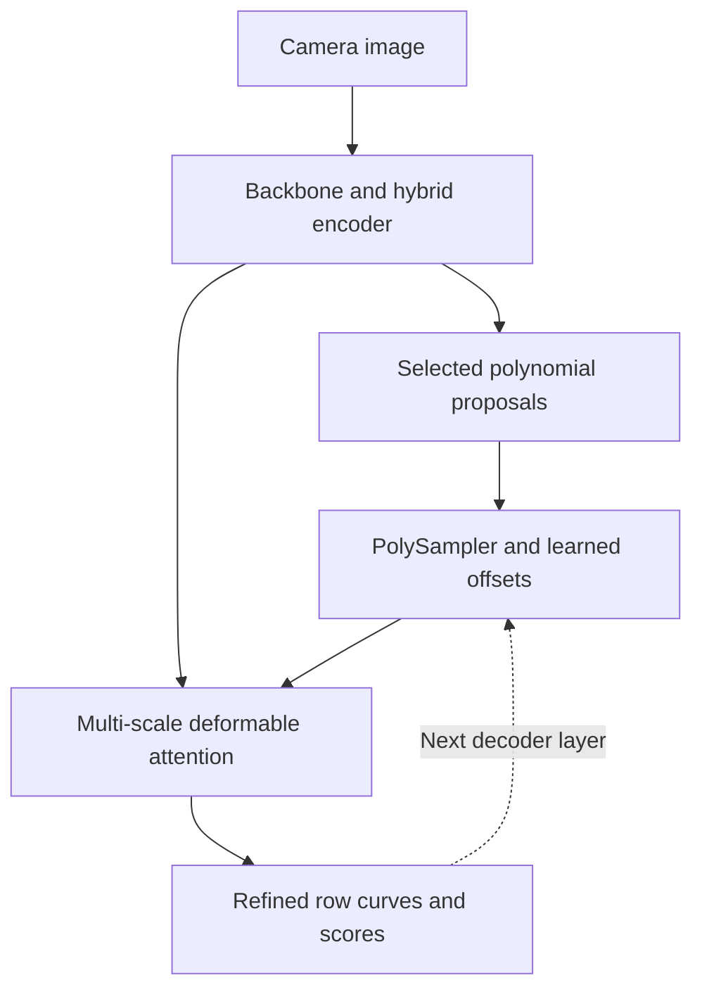

A crop row looks fairly obvious when you stand at the edge of a field. Put a camera on a small robot underneath the canopy, and the view changes. Leaves cover stalks, weeds interrupt the path, and gaps break up what should be a continuous structure. The robot still needs an estimate of where the rows run.

That problem motivated our work on **RowDetr**, developed with Ajay Sharda. We wanted a network that predicts the geometry of crop rows directly, with enough speed to be useful on agricultural robots. The resulting paper, [RowDetr: End-to-end crop row detection using polynomials](https://doi.org/10.1016/j.atech.2025.101494), appeared in *Smart Agricultural Technology* in 2025. The [RowDetr-v2 repository](https://github.com/r4hul77/RowDetr-v2) contains the official implementation. Here, I use RowDetr for the method and RowDetr-v2 for the codebase.

The central idea is to represent each row as a continuous parametric curve and use that same geometry to guide attention and training.

## Representing a crop row with two polynomials

A row detector needs to describe where a row goes through the image. A segmentation pipeline can produce a mask and then extract a curve from it. RowDetr predicts the curve parameters inside the network, removing the separate curve-fitting stage at inference.

For each row, we model both image coordinates as functions of a parameter that runs from zero to one:

$$
x = P_x(\lambda), \qquad y = P_y(\lambda), \qquad \lambda \in [0,1].
$$

The current training configuration uses quadratic polynomials:

$$
P_x(\lambda) = a_2\lambda^2 + a_1\lambda + a_0,
\qquad
P_y(\lambda) = b_2\lambda^2 + b_1\lambda + b_0.
$$

That gives us six coefficients per row, together with a score indicating whether the proposal corresponds to a row. Predicting both coordinates lets the representation accommodate different row orientations without requiring one image coordinate to be a function of the other.

To construct training targets, the `FitCurves` transform calculates cumulative distances between annotation points and divides by the total distance. These normalized distances provide the parameter values, called `alpha` in the code. It then fits the two polynomials to the annotated coordinates. This fitting happens during target preparation; the trained model predicts coefficients directly. See the [annotation transform](https://github.com/r4hul77/RowDetr-v2/blob/a6cbd6c75cca4652c009297a1ef89eea9a4a4a59/transforms/custom_transforms.py).

## Following row geometry through the network

RowDetr uses a backbone to extract image features and a hybrid encoder to combine information across feature scales. The decoder starts with polynomial proposals and refines them into row predictions. The [model implementation](https://github.com/r4hul77/RowDetr-v2/blob/a6cbd6c75cca4652c009297a1ef89eea9a4a4a59/models/poly_transformer.py) connects these components.



The interesting part is how the decoder gathers evidence for a proposed row. A polynomial already describes a path through the image. **PolySampler uses that path to choose where to sample features.**

The decoder evaluates the proposed polynomials at evenly spaced parameter values, samples features at those locations, and uses a small network to predict local offsets. Those adjusted locations become references for deformable attention. The decoder then updates its estimates using the collected features. The sampling and refinement logic lives in [decoders.py](https://github.com/r4hul77/RowDetr-v2/blob/a6cbd6c75cca4652c009297a1ef89eea9a4a4a59/models/decoders.py).

Think of a candidate curve passing slightly to the side of a visible row. Sampling along it provides an initial view of the nearby features; learned offsets let the decoder gather evidence around that estimate. Repeated refinement gives the proposal a way to move toward the row.

This is a useful design principle for structured vision tasks: the predicted geometry can help decide where the network should look next.

## Training against the shape of a curve

The loss function needs to reflect the geometry we care about. Comparing polynomial coefficients independently does not directly describe how far apart the resulting curves lie in the image.

**PolyOptLoss compares the predicted and target curves over their parameter interval.** Its geometric objective is the integrated squared distance:

$$
\mathcal{L}_{\mathrm{poly}} = \int_0^1
\left[
\big(P_x(\lambda)-\hat P_x(\lambda)\big)^2
+ \big(P_y(\lambda)-\hat P_y(\lambda)\big)^2
\right] d\lambda.
$$

Here, the hatted functions denote the target curve. Because the coordinate functions are polynomials, this integral can be evaluated analytically from their coefficients. The [PolyOptLoss implementation](https://github.com/r4hul77/RowDetr-v2/blob/a6cbd6c75cca4652c009297a1ef89eea9a4a4a59/models/losses.py) computes those interactions with tensor operations.

For agricultural imagery, this geometric view matters because annotations can be ambiguous wherever vegetation hides the row. The paper introduces PolyOptLoss to improve learning under that ambiguity. It still depends on useful annotations; the objective measures agreement with the target curve.

Training also needs to associate proposals with labeled rows. The [Hungarian matcher](https://github.com/r4hul77/RowDetr-v2/blob/a6cbd6c75cca4652c009297a1ef89eea9a4a4a59/models/matcher.py) assigns predictions to targets one to one. Extra proposals are treated as non-rows, allowing a fixed proposal set to represent images containing different numbers of visible rows.

## What the experiments showed

We evaluated RowDetr on 6,962 images spanning corn, sorghum, and the CropRow Detection Lincoln Dataset. The following figures are reported RowDetr test results, also reproduced in the [repository results table](https://github.com/r4hul77/RowDetr-v2#results).

| Backbone | Parameters | Latency ↓ | Lane position deviation ↓ | TuSimple-style F1 ↑ |
| --- | --- | --- | --- | --- |
| EfficientNet | 23M | 9.11 ms | 0.405 | 0.734 |
| ResNet18 | 31M | 6.70 ms | 0.421 | 0.736 |
| RegNetX 008 | 27M | 9.70 ms | 0.416 | 0.725 |
| ResNet50 | 44M | 9.25 ms | 0.413 | 0.740 |

The latency figures above are the RTX 4090 results, distinct from the paper's TensorRT INT8 deployment measurements on Jetson Orin AGX. TuSimple-style metrics were adapted to evaluate crop rows; these F1 scores describe the agricultural test set. See the [paper's experimental setup and results](https://arxiv.org/html/2412.10525v3#S3).

ResNet18 offered the lowest latency among these variants, while ResNet50 achieved the highest F1. EfficientNet had the fewest parameters and the lowest lane position deviation. The choice therefore depends on the deployment's priorities.

## Exploring the implementation

The most useful starting point is [train_scripts/run_dist.py](https://github.com/r4hul77/RowDetr-v2/blob/a6cbd6c75cca4652c009297a1ef89eea9a4a4a59/train_scripts/run_dist.py). It brings the model, data transforms, loss functions, and evaluators together. At the linked revision, it configures 640 × 384 images, quadratic curves, 100 proposals, and a RegNetX 008 backbone. The proposal count is the model's candidate capacity, rather than an expected count of visible rows.

After following the [repository setup instructions](https://github.com/r4hul77/RowDetr-v2#installation), prepare the `train` and `val` dataset directories and adjust their paths, batch size, and worker count in the training script. Run training from the repository root:

```bash
PYTHONPATH="${PWD}" python train_scripts/run_dist.py
```

For a closer look at the method, follow a target from `FitCurves` into the matching and loss code, then trace a proposal through `TransformerDecoder`. That connects the representation, supervision, and feature sampling in one place.

RowDetr estimates row curves in image space. Using those estimates to drive a robot also requires camera calibration, a navigation controller, and evaluation under the intended field conditions. For that perception component, the work shows how a compact geometric representation can connect the network's output, attention, and training objective.
